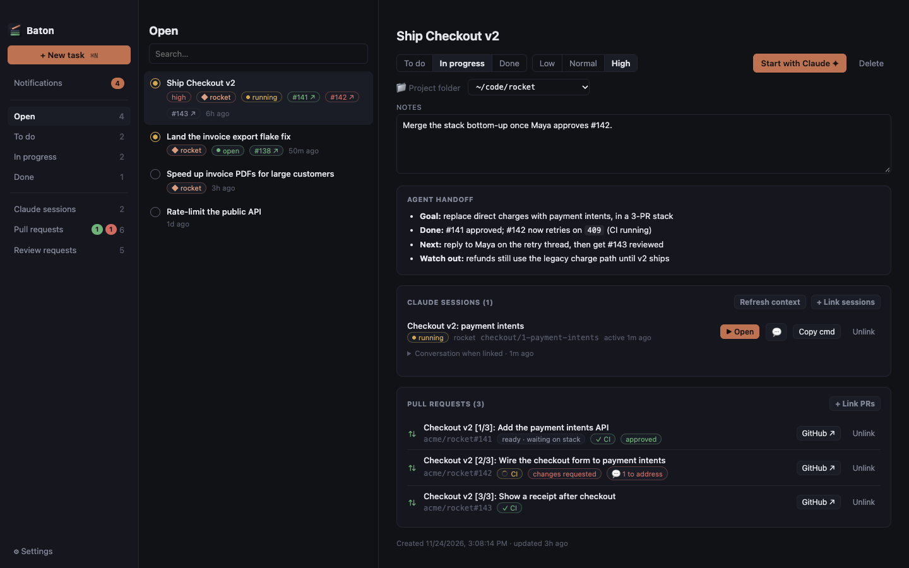

# Baton

Baton is a free, open-source desktop app for [Claude Code](https://docs.anthropic.com/en/docs/claude-code) users. Park unfinished sessions as tasks with the agent’s handoff notes, track your GitHub pull requests and stacked PRs, and get notified when Claude needs an answer or finishes. Runs on macOS, Windows and Linux.

**Website:** https://noras-salman.github.io/baton/ (served from `docs/`)



<sub>Screenshot uses made-up demo data.</sub>

## Download

Get the latest build for macOS (Apple silicon or Intel), Windows or Linux from [Releases](https://github.com/noras-salman/baton/releases/latest). Windows and Linux builds are beta.

## Install

```bash
npm install
npm run dist        # builds dist/Baton-<version>-arm64.dmg
```

Open the DMG and drag Baton to Applications. The build is ad-hoc signed and not notarized, so it's meant for your own Mac. The first time you open a copy downloaded from elsewhere, right-click the app and choose Open.

## Releasing

Push a version tag and GitHub Actions builds every platform and publishes the release:

```bash
npm version minor        # bumps package.json and tags vX.Y.Z
git push --follow-tags
```

Download file names don't change between versions, so the site's "latest" links keep working.

## Website and screenshots

The landing page lives in `docs/` (GitHub Pages: Settings → Pages → Deploy from branch → `main` / `docs`). Screenshots are taken from made-up demo data, never from a real account:

```bash
node scripts/demo/make-demo.js /tmp/baton-demo
BATON_HOME=/tmp/baton-demo/baton CLAUDE_CONFIG_DIR=/tmp/baton-demo/claude BATON_OFFLINE=1 \
  npx electron scripts/demo/screenshots.js docs/assets/screens
```

## Develop

```bash
npm start
```

## How it works

- **Sessions** are read directly from your existing Claude Code setup: transcripts in `~/.claude/projects` and running sessions in `~/.claude/sessions`. There is no separate login.
- **Open / Resume** opens the session in the VS Code Claude panel (via the extension's `vscode://anthropic.claude-code/open?session=…` link), or in Terminal or iTerm with `claude --resume <id>`, depending on Settings → General.
- **Tasks** are stored in `~/.baton/tasks.json`. The app updates live when the file changes.
- **Links**: a task can link any number of Claude sessions and GitHub PRs. Each linked session keeps a snapshot of its latest conversation. Use "Refresh context" to capture them again later.
- **Pull requests**: your open PRs and PRs waiting on your review come from the GitHub CLI's existing login (`gh auth status`). The app needs no tokens of its own. Results are cached in `~/.baton/prs-cache.json` and refreshed every 5 minutes, or with ⌘R in the PR view.
- **Stacks**: a PR whose base branch is another open PR's branch is grouped into a stack, shown root to leaf with overall status. "+ Task" links the whole stack and every session that worked on it.
- **Ready to merge**: not a draft, approved (or no review required), checks passing, no conflicts, no unresolved threads. A PR in a stack only counts as ready when the whole stack is ready.
- **To address**: your PRs with an unresolved review thread where someone else commented last, or with changes requested.
- **Background watcher**: the app polls GitHub every 3 minutes, including while the window is closed, and sends macOS notifications when a PR or a whole stack becomes ready to merge, or when someone comments on or reviews your PRs. Each event is notified once, tracked in `~/.baton/pr-notify-state.json`. The installed app adds itself as a login item on first run; turn this off in the sidebar.
- **Notifications history**: every notification is kept in the Notifications view (`~/.baton/notifications.json`, newest 500) with unread state, the comments that triggered it, a deep link to the comment, and the PR's current status. The Dock icon shows the unread count. Clicking a macOS banner marks it read and opens it in Baton. The notification toggles only mute the banners; history is always recorded.
- **Settings tab**: choose which events notify you (ready PRs, ready stacks, failing checks, review requests with who asked, human comments, bot and AI-reviewer comments, approvals, changes requested, finished Claude sessions), banners, Dock badge, and muted repos and PRs. Turned-off types aren't recorded.
- **Claude session finished**: Baton watches `~/.claude/sessions` and notifies you when a session goes from running to waiting for you, if it ran longer than your threshold (default 30 s).
- **Start with Claude**: from any task (or "Create & start Claude" in the New task dialog), pick a project folder, describe what needs to be done, and choose Plan first / ask before changes / auto-accept edits. Baton opens the Claude panel in VS Code with the prompt, or a new `claude` session in Terminal or iTerm, with a prompt built from the task, its handoff notes, linked PRs and earlier sessions, and links the new session to the task.
- **Claude waiting on you**: optional Claude Code hooks (Settings → Claude Code → Install hooks) notify you when a session shows a permission prompt, asks a question (AskUserQuestion), or has a plan to approve (ExitPlanMode). The hook runs `baton hook`, which drops an event in `~/.baton/inbox`. Installing merges into `~/.claude/settings.json`, keeps your other settings, and saves a `.baton-backup`.
- **Project folders**: each task has a project folder used by Start with Claude. The fallback order is the task's folder, then a linked session's folder, then the default folder from Settings, then the last folder you started in.
- **Merge**: "Merge…" on any PR (and on ready-to-merge notifications) shows what's still blocking, the merge methods the repo allows, and delete-branch. It runs `gh pr merge` pinned to the commit you saw (`--match-head-commit`), or enables auto-merge when the PR isn't ready yet. PRs in the middle of a stack point you to the bottom PR instead. After merging, it offers to mark linked tasks done.
- **PR conversation**: each PR shows its full comment history (description, review threads with file and line, reviews, comments), with All / Unresolved / Reviews filters.
- **Message Claude**: from a session, its notifications, or a task's linked sessions. Closed sessions continue in the background with `claude -p --resume <id>` (Auto / Accept edits / Plan), the reply lands in the same session, and you get a notification. Sessions open in VS Code get the message in their panel. Sessions open in a terminal have to be answered there.
- **Markdown**: PR comments, Claude's messages, and agent handoffs render markdown (headings, emphasis, code, links, lists, quotes, tables) with a built-in renderer that creates DOM nodes directly and never injects HTML. Links open in your browser.
- **Approve**: "✓ Approve…" on PRs you didn't author submits an approving review with `gh pr review --approve`, with an optional comment. It warns first about failing checks, open threads, drafts, or conflicts.
- **PR ↔ session matching**: a session counts as linked to a PR if its transcript recorded that PR (Claude Code writes a `pr-link` entry when a session creates or touches one) or if the session ran on the PR's branch.

## `/task` inside Claude Code

Install it from the sidebar button, or run `npm run install-skill`. This writes `~/.claude/skills/task/SKILL.md`.

Then, in any Claude Code session:

```
/task                      # agent infers what's pending
/task follow up on PR review comments after CI passes
```

The agent writes a handoff summary (state, next steps, key files and decisions) and saves it as a task linked to the current session.

## CLI

```bash
node bin/baton.js add --title "..." [--session <id>]... [--pr <url>]... [--context "..."] [--priority high]
node bin/baton.js list
```

## License

[MIT](LICENSE) © 2026 Noräs Salman. Baton is an independent project, not affiliated with or endorsed by Anthropic.
